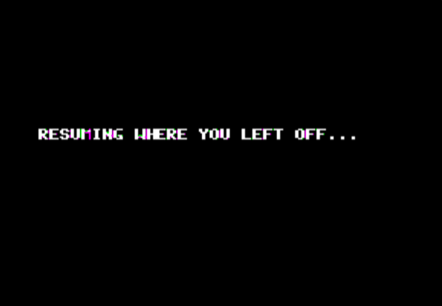

# Beyond Castle Wolfenstein: purple door

Patches and tools for making the purple door in the cabinet room of *Beyond Castle Wolfenstein*
(Muse Software, 1984, Apple II, DOS 3.3) passable, plus a way to drive the Apple2TS emulator in the
background to test them.

> [!NOTE]
> **Made with AI.** This project was built with AI coding assistants working under my direction:
> the first version of the patch with [GitHub Copilot](https://github.com/features/copilot), and
> the patches, tools, tests and documentation since then with
> [Claude Code](https://www.anthropic.com/claude-code), Anthropic's AI coding assistant (Claude).
> I directed the work and play-tested the patched game. Commits an assistant wrote or co-wrote
> name it in a `Co-Authored-By` trailer.

- **Patches** take a disk image of the game in, and write a new, patched image out. Nothing here is
  the game itself.
- **Tools** rebuild and verify the patched images by hash, and run Apple2TS headless (no window) so a
  script can restore a saved state, read memory and capture screenshots.

Who it is for: people modding or studying the game, and anyone who wants to script Apple2TS.



*The patched game, recorded in Apple2TS: the purple door (magenta, right of the table) no longer blocks anyone.*

## You supply the game

The game image is copyrighted and is **not** in this repo. The patches target the 4am crack of the
game: a raw DOS-order, 143,360-byte, 35-track `.dsk` with SHA-256 starting `5898ae8f`. Put it at
`Beyond Castle Wolfenstein (4am crack)/Beyond Castle Wolfenstein (4am crack).dsk` in the repo root
(gitignored), or point `BCW_IMAGE` at it. Play the patched copy and keep the original untouched.

## Quick start

Requirements: Python 3.12 (standard library only), Node 24 or newer, and `shellcheck`.
Chromium and an Apple2TS web build are needed only for the emulator tools (see
[`tools/README-a2ts.md`](tools/README-a2ts.md)). [CiderPress II](https://ciderpress2.com/) is
optional: if `apps/cp2/cp2` exists, `tools/verify.sh` also checks each rebuilt image's DOS 3.3
filesystem with it.

End of support (from [endoflife.date](https://endoflife.date/), checked 2026-11-22): Node 24 on
2028-04-30, Python 3.12 on 2028-10-31, and the CI runner image (Ubuntu 24.04) on 2029-05-31. Before
a date passes, move to the next supported release: update the version here, in `CLAUDE.md`,
`CONTRIBUTING.md`, `docs/Third-Party.md`, `package.json` (`engines`), `pyproject.toml`
(`target-version`) and `.github/workflows/ci.yml`, then run `tools/test.sh` and `tools/lint.sh`.

```sh
tools/verify.sh                      # rebuild every patched image from your game image and check hashes (~1 s)
tools/test.sh                        # full suite: Python tests, Node tests, hash check
cd patches
python3 apply_bcw_purple_door_patch.py ../"Beyond Castle Wolfenstein (4am crack)"/*.dsk /tmp/door.dsk
```

That last command writes a new image with the local purple-door patch; the input is not modified.
The result is expected to hash to `3d843c2c...`.

Dev tooling is optional and has no effect on the tools themselves:

```sh
python3 -m venv .venv && .venv/bin/pip install -r requirements-dev.txt && npm ci   # once
tools/lint.sh            # shellcheck, ruff, eslint, prettier (add --fix to apply fixes)
tools/audit.sh           # pip-audit and npm audit on the dev dependencies
```

### Environment variables (all optional)

Nothing needs to be set; these only override the defaults.

| Variable | Used by | Default |
|---|---|---|
| `BCW_IMAGE` | `tools/test.sh`, `tools/verify.sh` (as its argument), the tests | `Beyond Castle Wolfenstein (4am crack)/Beyond Castle Wolfenstein (4am crack).dsk` |
| `CP2` | `tools/verify.sh`, `tools/cp2_check.py`, the cp2 tests | `apps/cp2/cp2` |
| `A2TS_DIST` | `tools/bcw_up.sh` (the Apple2TS web build to serve) | `a2ts-web/dist` |
| `A2TS_BRIDGE` | `tools/a2ts_ctl.mjs` (host:port of the bridge) | `127.0.0.1:8765` |
| `TMPDIR` | `tools/bcw_up.sh`, `tools/bcw_down.sh` (where the bridge's PID file and log go) | `/tmp` |

## What is in here

| Path | Contents |
|---|---|
| `patches/` | The Python patcher, its `dos33.py` helpers (keep them together) and IPS files. |
| `docs/` | How the door is made solid, what each patch changes, project notes, untried ideas. |
| `tools/` | `verify.sh`, `test.sh`, `ips_apply.py`, and the headless emulator scripts. |
| `tests/` | Unit tests (`unittest` and `node:test`). Tests that need the game image skip without it. |
| `examples/` | Small runnable scripts: patch an image, read the room number from the emulator. |
| `reference/` | Screenshots and a short recording (`cabinet-room.webp`) of the room. |
| `apps/`, `a2ts-web/` | Local only and gitignored: the Apple2TS AppImage, its web build and saved emulator states. |

Start with [`docs/Project-Notes.md`](docs/Project-Notes.md); [`docs/ARCHITECTURE.md`](docs/ARCHITECTURE.md) explains how the pieces fit, and [`ROADMAP.md`](ROADMAP.md) lists what is next. The local patch affects only room `$3C`,
but guards can walk through the door too.

## Contributing

See [`CONTRIBUTING.md`](CONTRIBUTING.md); in short:

- Branch `main`. One logical change per commit; subject in the imperative mood, at most 72 characters.
- Run `tools/test.sh` and `tools/lint.sh` before committing; they should be clean.
- Never commit game images, saved states or emulator builds (`.dsk`, `a2ts-web/`, ... are gitignored).
- Secrets and personal data never go in code, logs or commits.

## License and credits

The code and documentation in this repo are [MIT licensed](LICENSE). That does not cover the game,
which belongs to its rights holders, or the 4am crack of it ([archive.org](https://archive.org/details/Passport4am)).
The screenshots and the recording in `reference/` and `tools/refs/` are frames from the game, included
to document the room and to drive the emulator menus.

The emulator tools use [Apple2TS](https://github.com/ct6502/apple2ts) by Chris Torrence (CT6502),
which is MIT licensed, running in [Chromium](https://www.chromium.org/) (BSD-3-Clause). Its web build
is downloaded separately and is not redistributed here.

The optional filesystem check uses [CiderPress II](https://github.com/fadden/CiderPress2) by Andy
McFadden, whose source is Apache-2.0 licensed (its images and documentation are CC BY-SA 4.0). It is
downloaded separately and is not redistributed here.

The tools run on [Python](https://www.python.org/) (PSF-2.0) and [Node.js](https://nodejs.org/) (MIT);
development uses ruff, pip-audit, ESLint, Prettier, ShellCheck, gitleaks, GitHub Actions and CodeQL.
Every third-party piece, with its version, license and link, is listed in
[`docs/Third-Party.md`](docs/Third-Party.md).
